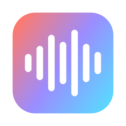

<p align="center"></p>

<h1 align="center">Murmur</h1>

**TL;DR: Wispr-Flow-style voice dictation for macOS that runs 100% on your Mac. Tap a key, talk, and clean text appears at your cursor about a second after you stop. Speech-to-text is NVIDIA Parakeet (via whisper.cpp, on the GPU), cleanup and "Ask AI" use a local model through Ollama, and a third mode turns what you say into a Claude Code session. No cloud, no account, no telemetry.**

## What it does

| Mode | Shortcut | What happens |
|---|---|---|
| **Dictate** | `⌃⌥Space` (or macro pad key 1 = F18) | Transcribes, removes "um/uh", applies "actually no, make it 4" corrections, pastes into the focused app |
| **Ask AI** | `⌃⌥/` (or pad key 2 = F19) | Speak a question; a floating panel streams the answer. Press again for a follow-up. Copy or Insert |
| **Claude Code** | `⌃⌥Return` (or pad keys 1+2 together) | Opens a [cmux](https://cmux.dev) (optional) workspace running `claude "<what you said>"`. If you're looking at a Claude session in cmux, it sends the instruction there instead |

- **Tap** to start, and it **stops automatically when you stop talking** (Silero VAD, adjustable pause). Or **hold** for push-to-talk. `Esc` cancels.
- Your clipboard is restored after pasting, and dictations are marked transient so clipboard managers skip them.
- Menu bar dropdown, searchable history, and per-app context for cleanup.
- Agent mode will only ever type into a pane whose foreground process is `claude`, never into a plain shell.

Measured on an M1 Pro: ~0.2 s to transcribe 12 s of speech, ~1 s for cleanup with `qwen3:4b-instruct`.

## Install (Apple Silicon, macOS 14+)

```sh
git clone https://github.com/1300Sarthak/murmur.git && cd murmur
./scripts/setup.sh
```

`setup.sh` installs `whisper-cpp` and `ollama` with Homebrew, downloads the models (~1.3 GB total) into `~/Library/Application Support/Murmur/models`, pulls `qwen3:4b-instruct`, builds, and launches. It needs no admin rights: it installs to `~/Applications` if `/Applications` isn't writable, and signs ad-hoc if you have no developer certificate.

On first launch, allow **Microphone** and **Accessibility** (Accessibility is what lets it paste). Without Accessibility it copies to the clipboard instead.

Requirements: Apple Silicon, macOS 14+, Homebrew, Xcode or Command Line Tools with Swift 5.9+.

Without an Apple Development certificate the app is signed ad-hoc, so macOS may ask for the permissions again after each rebuild.

### Models

| Model | WER on 73 LibriSpeech clips | Notes |
|---|---|---|
| Parakeet TDT 0.6B **v2** | **2.78%** | English-only, most accurate. `MURMUR_MODEL=v2 ./scripts/setup.sh` (community ggml conversion) |
| Parakeet TDT 0.6B v3 | 3.65% | Default, official [ggml-org](https://huggingface.co/ggml-org/parakeet-GGUF) weights, 25 languages |

Switch models in Settings. Any `ggml-parakeet-*.bin` you drop into the models folder shows up there.

## Macro pad (optional)

Cheap 3-key + knob pads (USB `1189:8890`) can be remapped with [ch57x-keyboard-tool](https://github.com/kriomant/ch57x-keyboard-tool):

```sh
cargo install ch57x-keyboard-tool
ch57x-keyboard-tool upload < macropad/murmur-pad.yaml   # F18, F19, play/pause, knob = volume
```

These pads send press and release together, so the keys act as toggles. Auto-stop ends the recording.

## Claude Code mode

Needs [cmux](https://cmux.dev) and the `claude` CLI. In Settings you can set:

- **Start in folder**: the working directory for new sessions
- **Extra claude flags**: for example `--permission-mode auto`
- **cca account** (optional): to launch through a `cca <account>` multi-account wrapper instead of plain `claude`

The prompt is passed through a file, so spoken text is never parsed by your shell.

## Privacy

Everything runs locally. The only network calls are to Ollama on `127.0.0.1`. History is stored in `~/Library/Application Support/Murmur/history.json`; clear it from the History window.

## Development

```sh
./scripts/build.sh                          # build + install
Murmur.app/Contents/MacOS/Murmur --demo     # cycle UI states with fake data (no mic, no paste)
Murmur.app/Contents/MacOS/Murmur --selftest clip.wav   # transcribe + clean up a file, print timings
Murmur.app/Contents/MacOS/Murmur --vadtest clip.wav    # show where auto-stop would trigger
python3 scripts/eval-cleanup.py Resources/cleanup-prompt.txt   # evaluate the cleanup prompt
```

Code map: `Engines.swift` (Parakeet, Silero VAD, audio capture, Ollama), `AppModel.swift` (state machine), `Agent.swift` (cmux / Claude Code), `System.swift` (hotkeys, paste, prefs, history), `Views.swift` and `Panels.swift` (UI).

## License

MIT
